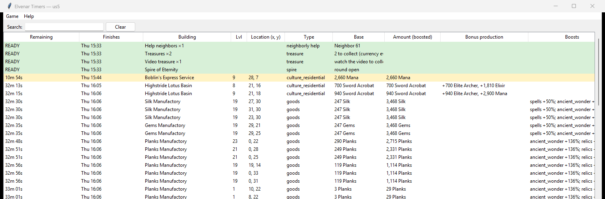
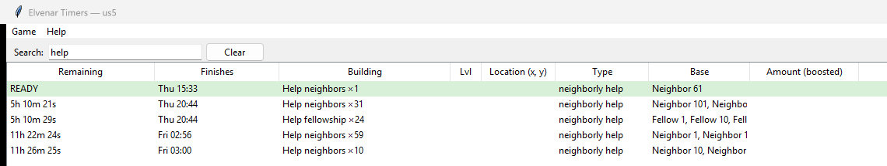
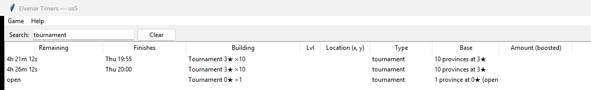

# Elvenar Timers

A small Windows app that shows **every production timer in your Elvenar city in one list**: what's ready now, what's next, and when everything finishes. No more clicking around the city to check.

**[⬇ Download the latest version](https://github.com/ginahixx/elvenar-timers/releases/latest)** (Windows 10/11, Edge or Chrome, any world)

## What it shows

- **Every building's timer**, soonest first. Ready ones are pinned on top in green, and anything finishing within 30 minutes is yellow.
- **What you'll get**: base and boosted amounts, bonus outputs from event buildings, the boosts that apply, and where the building is on your map.
- **Random rewards** (e.g. Genie, Bubblebeat Galleon): what the building could give.
- **Early collection** (e.g. Weeping Willow): when it can be collected early, and when the full cycle is done.
- **Queues** in barracks and the Magic Academy: the current item and when the whole queue is done.
- **Spell time left** on manufactories and workshops.
- **Spire of Eternity**: when the next round opens.
- **Tournament**: provinces grouped by stars and when they unlock.
- **Treasures and video treasures** waiting in your city, so you know to go looking.
- **Neighborly help you can give**: fellowship members and neighbors, grouped by when they're ready.
- **Guardians**: ready, active or on cooldown, with the real cooldown time.
- **Search** across everything: type "ready", "early", "help", a building or a product.

Who can you help next? Search "help":

Tournament provinces by star level and unlock time:

*Screenshots are from a real us5 city; player names are replaced.*

## Is it safe to use?

It only **reads** what the game already sends to your browser. It never clicks, never sends anything to the game, and never spends anything. The game runs in its own browser window, and you play there as normal. Nothing is uploaded anywhere; all its data stays on your PC.

InnoGames' Terms of Service prohibit third-party tools, so use it at your own risk.

Elvenar Timers is a fan-made tool, not affiliated with or endorsed by InnoGames. Elvenar is a trademark of InnoGames GmbH. The app icon is original artwork.

---

# User guide

This guide is also in the app under **Help > User guide**.

## Install

1. Download `ElvenarTimers.exe`, plus the `ElvenarTimers.exe.sha256` file published next to it, from the [latest release](https://github.com/ginahixx/elvenar-timers/releases/latest).
2. Check the download is intact. In PowerShell run `Get-FileHash ElvenarTimers.exe -Algorithm SHA256` and compare it to the value in the `.sha256` file (SHA-256).
3. Double-click the exe. Windows SmartScreen may say "Windows protected your PC" because the exe is unsigned. Click "More info", then "Run anyway".

Nothing else is downloaded or installed. You do not need Python. SmartScreen only complains because the exe is unsigned; the SHA-256 check above is how you know it is the real file.

## First run

- The app opens Elvenar in your default browser (Edge and Chrome; Brave, Vivaldi and Opera on a best-effort basis) using a separate profile. Log in once in THAT window and play there. The timers only see that window.
- If your default browser is Firefox you will see "Firefox isn't supported yet. Edge and Chrome both work. Choose which one opens the game (Edge is already on your PC)." and can pick Edge or Chrome (Chrome is only offered if it is installed). The app remembers your choice.
- It asks which world you play (for example us5, en2, de3). Leave it blank to pick the world on the Elvenar website.
- The game window shows a grey bar: "You are using an unsupported command-line flag: --disable-blink-features=AutomationControlled". This is expected and harmless. That setting stops the page from treating the window as a remote-controlled test browser. Close the bar with its X.

## Using it

Countdowns tick live. Collecting a building in the app's game window updates its row. Collections made in another browser or on mobile show up after you reload the game page. Type in the Search box above the table to show only matching rows: it searches every column as shown, so "early", "ready", "waiting" or a booster name work as well as building names, products and locations. Rows join or leave the results as their countdown text changes. Clear shows everything again. Ready buildings stay on top. Event buildings that produce several things at once list the extra outputs in the "Bonus production" column.

Extra things in the table:

- **Queues** (barracks, Magic Academy): Remaining shows the current item and the whole queue, e.g. `0m 23s · all 5h 12m`; Finishes shows both clock times.
- **Early collection** (e.g. Weeping Willow): Remaining adds `early in 1h 10m`, then `early now` with a pale green row; the row turns full green when the whole cycle is done.
- **Random rewards** (e.g. Genie, Bubblebeat Galleon): Bonus production lists what the building could give, e.g. `could be: 5,800 Marble · 3 Knowledge Points · Broken Shards`.
- **Spell left**: time left on a spell cast on that building.
- **Spire of Eternity**: next round countdown, or READY when the round is open.
- **Tournament**: provinces grouped by stars and unlock time (rounded up to 5 minutes); an unfought province shows "open". Appears after you open the world map.
- **Treasures** and **Video treasure**: how many are in your city right now, so you know to go looking. Each clears when you collect it or watch the video in the app's game window.
- **Help fellowship** / **Help neighbors**: when you can give neighborly help again, grouped by the hour, with player names in Base. Fellowship shows straight away; neighbors appear after you open the world map.
- **Guardians**: ready, active (with the cooldown that follows, e.g. `active, then 6h cooldown`) or cooldown. When the active time ends the row switches to the real cooldown countdown. While one is active, the others show "waiting".

## If something looks wrong

- Banner "Couldn't read city data, the game may have updated": the game changed its data format. The game still works; the table is greyed out until the app is updated.
- "unknown" rows are single buildings the app doesn't understand yet.
- If you close the game window, click "Reopen game window".

## Your data

Everything stays in `%APPDATA%\ElvenarTimers` (login profile, settings, logs, small redacted samples). Delete that folder to reset or log out. Nothing is uploaded.

## Fair-play note

InnoGames' Terms of Service prohibit third-party tools and automation. This app only reads what the game already sends to your browser and never acts on your behalf, but you use it at your own risk.

Elvenar Timers is a fan-made tool, not affiliated with or endorsed by InnoGames. Elvenar is a trademark of InnoGames GmbH. The app icon is original artwork.
